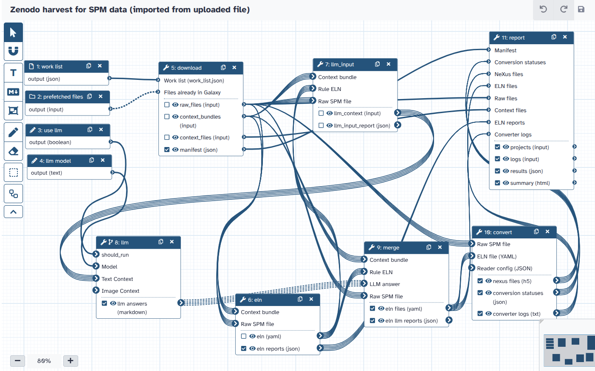

# Zenodo harvest for SPM data

Goal: turn openly licensed scanning probe microscopy (SPM) datasets on [Zenodo](https://zenodo.org)
into [NeXus](https://www.nexusformat.org) files and [NOMAD](https://nomad-lab.eu) projects that link
back to the Zenodo DOI.

The `zenodo_harvest` Action of
[nomad-eosc-galaxy-actions](https://github.com/FAIRmat-NFDI/nomad-eosc-galaxy-actions) decides what to
harvest, starts this workflow and creates the NOMAD projects from its outputs. The workflow only
computes; it writes nothing to NOMAD.

```
work list ─► download + unzip ─► ELN builder ─► LLM input ─► LLM Hub ─► check + merge ─► NeXus converter ─► report builder
                                  (per raw file)                (if "use llm")              (per raw file)
```

The LLM part is on by default and can be turned off. An LLM fills the ELN fields the rules leave
empty; only values with a quote found in the dataset's files are kept (see the tools' README).

The tools are in [`tools/zenodo_nomad_harvest`](../../tools/zenodo_nomad_harvest/).



## Inputs and outputs

| Name | Content |
|---|---|
| `work list` (input, step 0) | `work_list.json` from the Action |
| `prefetched files` (optional input) | Files already in Galaxy; element identifier = Zenodo file name |
| `use llm` (input, default `true`) | Let [LLM Hub](https://github.com/bgruening/galaxytools/tree/master/tools/llm_hub) fill the empty ELN fields |
| `llm model` (input, default `mistral-medium-3.5-e-infra.cz`) | LLM Hub **multimodal** model (a value of the server's `genai_models` table). The type is fixed to "Multimodal models": Galaxy 25.0 cannot connect an input to LLM Hub's type selector |
| `manifest` | Every archive and file, with its role and what happened to it |
| `results` | Conversion status per raw file |
| `projects` | One NOMAD project zip per Zenodo record |
| `logs`, `summary` | A log per record, and an HTML summary of the run |
| `eln files`, `eln reports`, `nexus files`, `conversion statuses`, `converter logs` | Outputs of the middle steps; `eln files` are the ELNs the converter read |
| `eln llm reports`, `llm answers` | Per raw file: LLM values kept or dropped (with the reason), and the LLM's answer |

The Action reads the outputs by these labels, so keep them when you edit the workflow.

## Files

| File | Use |
|---|---|
| `zenodo-harvest-spm.ga` | Import in Galaxy (*Workflows → Import*, from this file or its raw GitHub URL) |
| `zenodo-harvest-spm.gxwf.yml` | Source ([gxformat2](https://github.com/galaxyproject/gxformat2)); edit this one |
| `zenodo-harvest-spm-tests.yml` | `planemo test` cases for the `.ga` (LLM off) |

After editing the source, regenerate the `.ga` and test it:

```bash
gxwf-to-native zenodo-harvest-spm.gxwf.yml zenodo-harvest-spm.ga
planemo test --docker --conda_auto_install --extra_tools ../../tools/zenodo_nomad_harvest \
    --extra_tools ../../tools/llm_hub zenodo-harvest-spm.ga
```

The `.ga` uses the tools' short IDs. Once the tools are in the Tool Shed, re-export it from the Galaxy
server so it has their full Tool Shed IDs.

Author: Rubel Mozumder ([FAIRmat](https://www.fairmat-nfdi.eu/fairmat/))
